# 🏢 বাংলাদেশ রিয়েল এস্টেট এন্টারপ্রাইজ ইআরপি (Bangladesh Real Estate Enterprise ERP)
## ক্লায়েন্ট প্রেজেন্টেশন ও এক্সিকিউটিভ লাইভ ডেমো গাইড (Executive Presentation & Live Demo Master Playbook)

> **লক্ষ্য (Objective)**: এই গাইডটি অনুসরণ করে আপনি ক্লায়েন্টের সি-লেভেল এক্সিকিউটিভ—**Managing Director (MD), Chairman, Director of Sales, Chief Financial Officer (CFO), Head of Engineering, এবং Head of Legal**—এর সামনে ১০০% আত্মবিশ্বাসের সাথে একটি বিশ্বমানের, তথ্যবহুল ও মোক্ষম ডেমো উপস্থাপন করতে পারবেন।  
> **সিস্টেমের বর্তমান অবস্থা**: ডাটাবেজের সমস্ত ৬০+ টেবিলে বাস্তবসম্মত বাংলাদেশি রিয়েল এস্টেট ডেমো ডাটা (প্রজেক্ট, টাওয়ার, ফ্ল্যাট, বায়নানামা, ভাউচার, লেবার মাস্টার রোল, এনবিআর মূসক চালান, লিগ্যাল ক্লিয়ারেন্স ও বিআই মেট্রিক্স) সম্পূর্ণরূপে লোড করা আছে।

---

## 🔑 ডেমো অ্যাকাউন্টের ক্রেডেনশিয়াল ও ভূমিকা (Demo Login Credentials)

| ভূমিকা (Role) | ইউজারনেম (Username) | পাসওয়ার্ড (Password) | প্রবেশযোগ্য ড্যাশবোর্ড ও সুযোগ-সুবিধা |
| :--- | :---: | :---: | :--- |
| **Group Admin / Managing Director** | `admin` | `admin` | পূর্ণ প্রশাসনিক ক্ষমতা, এক্সিকিউটিভ বিআই ককপিট, এপ্রুভাল ইঞ্জিন, আর্থিক অডিট |
| **Project Director / Site Engineer** | `kamal` | `kamal` | কনস্ট্রাকশন ডিপিআর, লেবার মাস্টার রোল, মেটেরিয়াল রিকুইজিশন, কিউব টেস্ট |
| **Customer Portal (Flat Owner)** | `01711998822` | `portal123` | ফ্ল্যাট ওনার সেলফ-সার্ভিস পোর্টাল, কনস্ট্রাকশন গ্যালারি, পেমেন্ট লেজার |

> [!TIP]
> **লগইন শর্টকাট**: টপবারে ইউজারের প্রোফাইল আইকনে ক্লিক করলেই **"Quick Switch Persona"** মেনু পাবেন। প্রেজেন্টেশনের মাঝখানে কোনো লগআউট ছাড়াই ১-ক্লিকে **Admin** থেকে **Site Engineer** রোল সুইচ করে দেখাতে পারবেন!

---

## ⏱️ প্রেজেন্টেশন টাইমলাইন ও স্ট্র্যাটেজি (The Winning Flow)

```mermaid
graph LR
    A["১. এক্সিকিউটিভ হুক (৫ মি.)"] --> B["২. এক্সিকিউটিভ বিআই ককপিট (১০ মি.)"]
    B --> C["৩. ভিজ্যুয়াল টাওয়ার স্ট্যাকিং (৭ মি.)"]
    C --> D["৪. মেকার-চেকার গভর্ন্যান্স (৫ মি.)"]
    D --> E["৫. সাইট ডিপিআর ও প্রকিউরমেন্ট (৮ মি.)"]
    E --> F["৬. একাউন্টস, CWIP ও মূসক ৬.৩ (১০ মি.)"]
    F --> G["৭. লিগ্যাল ভল্ট ও কাস্টমার পোর্টাল (৫ মি.)"]
    G --> H["৮. হ্যান্ডওভার ও ডিল ক্লোজিং (৫ মি.)"]
```

---

## ১. প্রেজেন্টেশন স্ট্র্যাটেজি ও এক্সিকিউটিভ হুক (The Executive Pitch)
**সময় বরাদ্দ:** ৫ - ৭ মিনিট  
**মূল কথা:** "কেন জেনেরিক ইআরপি (যেমন Odoo, Tally বা SAP) বাংলাদেশের রিয়েল এস্টেট ইন্ডাস্ট্রিতে ৯০% ক্ষেত্রে ব্যর্থ হয়?"

### প্রেজেন্টার ডায়লগ (কী বলবেন ক্লায়েন্টকে):
> *"আসসালামু আলাইকুম। আপনারা জানেন, রিয়েল এস্টেট বাংলাদেশের সবচেয়ে ক্যাপিটাল-ইনটেনসিভ ব্যবসা। কিন্তু দুঃখজনক হলেও সত্য, দেশের অধিকাংশ শীর্ষ ডেভেলপার কোম্পানি এখনো এক্সেল শিট আর বিচ্ছিন্ন সফটওয়্যার দিয়ে শত কোটি টাকার প্রজেক্ট পরিচালনা করছেন।*
> 
> *সাধারণ কোনো সফটওয়্যার দিয়ে বাংলাদেশের রিয়েল এস্টেট চালানো যায় না—কারণ এখানে প্রয়োজন কাঠা-ডেসিমেল-বিঘা জমির হিসাব, রাজউক ইমারত নির্মাণ বিধিমালা অনুযায়ী FAR ক্যালকুলেশন, জমির মালিকের ৫০:৫০ জেভি অনুপাত বণ্টন, রিহ্যাব বিধিমালার ১০% ডিডাকশন রুলস, এনআই অ্যাক্ট ১৮৮১ ধারা ১৩৮ চেক বাউন্স লিগ্যাল নোটিশ, এনবিআর মূসক ৬.৩ ও ধারা ৫৩এফএফ এর অগ্রিম আয়কর।*
> 
> *আমাদের তৈরি এই সিস্টেমটি কোনো সাধারণ সফটওয়্যার নয়—এটি **বাংলাদেশের রিয়েল এস্টেট ডেভেলপারদের সম্পূর্ণ নিজস্ব আইনি, আর্থিক ও প্রকৌশল কাঠামোর উপর ভিত্তি করে তৈরি একটি ১০০% স্পেশালাইজড এন্টারপ্রাইজ সল্যুশন**।"*

---

## ২. মডিউল-বাই-মডিউল লাইভ ডেমো ওয়াকথ্রু (Live Demo Script)

---

### পর্ব ১: এক্সিকিউটিভ বিআই ককপিট ও ক্যাশ রানওয়ে (The MD/Board Showstopper)
**ইউআরএল:** `http://localhost:4200/bi/cockpit`  
**টার্গেট অডিয়েন্স:** Managing Director, Chairman, Chief Financial Officer

#### যা দেখাবেন ও মুখে বলবেন:
1. **পোর্টফোলিও টোটাল অ্যাসেট ভ্যালু (Portfolio Valuation Card):**
   - স্ক্রিনে দেখান **৳৮৫০ কোটি টাকার পোর্টফোলিও অ্যাসেট**, যার মধ্যে ৳৫৪০ কোটি বিক্রি সম্পন্ন এবং ৳৩১০ কোটি টাকার আনসোল্ড ইনভেন্টরি।
   - **বলবেন:** *"ম্যানেজিং ডিরেক্টর এবং বোর্ড মেম্বাররা সকালে সফটওয়্যারে ঢুকেই এক নজরে পুরো গ্রুপের সমস্ত প্রজেক্টের একত্রিত আর্থিক স্বাস্থ্য দেখতে পারবেন।"*
2. **১৮০ দিনের নেট ক্যাশ রানওয়ে সিমুলেটর (Net Cash Runway):**
   - স্ক্রিনে দেখান: আগামী ৯০ ও ১৮০ দিনে কাস্টমারদের কিস্তি থেকে প্রত্যাশিত ক্যাশ ইনফ্লো (৳৪২ কোটি) বনাম সাইটের রড, সিমেন্ট ও ঠিকাদারের প্রদেয় লায়াবিলিটি (৳২৮ কোটি)।
   - **মাস্টার স্ট্রোক পয়েন্ট:** *"কোনো মাসে যেন ক্যাশ ক্রাঞ্চ বা অর্থের ঘাটতি তৈরি না হয়, সেজন্য সিস্টেম ৯০ ও ১৮০ দিনের প্রজেকশন আগে থেকেই ওয়ার্নিং দেয়।"*
3. **আর্নড ভ্যালু ম্যানেজমেন্ট (EVM: SPI & CPI):**
   - স্ক্রিনে দেখান **Schedule Performance Index (SPI = 1.04)** এবং **Cost Performance Index (CPI = 1.08)**।
   - **বলবেন:** *"ইন্টারন্যাশনাল পিএমআই (PMI) স্ট্যান্ডার্ড অনুযায়ী প্রজেক্ট সময়ের আগে চলছে নাকি বাজেটের বেশি খরচ হচ্ছে, তা রিয়েল-টাইমে জানা যায়।"*
4. **ওভারডিউ কালেকশন হিটম্যাপ (Overdue Heatmap):**
   - কোন প্রজেক্টে বা কোন ফ্লোরে কাস্টমারদের কিস্তি ৯০ দিনের বেশি বকেয়া আছে, তা কালার-কোডেড হিটম্যাপে তাৎক্ষণিক চিহ্নিত করা যায়।

---

### পর্ব ২: ভিজ্যুয়াল ২ডি টাওয়ার স্ট্যাকিং প্ল্যান ও ১৫-মিনিটের মিউটেক্স লক
**ইউআরএল:** `http://localhost:4200/inventory/stacking-plan`  
**টার্গেট অডিয়েন্স:** Director of Sales, Sales Managers, Operations Head

#### যা দেখাবেন ও মুখে বলবেন:
1. **আর্কিটেকচারাল এলিভেশন গ্রিড (2D Tower Elevation):**
   - গ্র্যান্ড এমারেল্ড টাওয়ারের বেসমেন্ট থেকে রুফটপ পেন্টহাউস পর্যন্ত সমস্ত ফ্লোরের এলিভেশন স্ক্রিনে দেখান।
   - প্রতিটি ফ্ল্যাটের লাইভ স্ট্যাটাস কালার কোডিং:
     - 🟢 **Available (সবুজ)**: বিক্রয়ের জন্য উন্মুক্ত।
     - 🟡 **Under 15-Min Reservation (হলুদ)**: বুকিং আলোচনারত।
     - 🔴 **Sold / Booked (লাল)**: বায়নানামা সম্পাদিত।
     - 🔵 **Landowner Share (নীল)**: জমির মালিকের জন্য সংরক্ষিত।
     - 🟣 **Commercial Lease (বেগুনি)**: কোম্পানির নিজস্ব ভাড়ার সম্পদ।
2. **১৫ মিনিটের ডিসট্রিবিউটেড মিউটেক্স লক (Distributed Redis Lock):**
   - যেকোনো একটি Available ইউনিটে ক্লিক করে **"Instant Reserve"** দিন।
   - সাথে সাথে স্ক্রিনে **১৫ মিনিটের কাউন্টডাউন টাইমার** চালু হবে এবং ইউনিটটি হলুদ হয়ে লক হবে।
   - **মাস্টার স্ট্রোক পয়েন্ট:** *"মেলা বা শুক্রবারে ধানমন্ডি সেলস অফিসের প্রতিনিধি এবং গুলশান প্রধান কার্যালয়ের প্রতিনিধি যদি একই সেকেন্ডে ফ্ল্যাট ৫-এ বিক্রি করতে চান, সিস্টেম প্রথমজনকে ১৫ মিনিটের মিউচুয়াল এক্সক্লুসিভ লক দেবে। ডাবল-সেলিংয়ের কোনো সুযোগ নেই!"*
3. **স্লাইড-ওভার ইউনিট ডিটেইল ড্রয়ার ও অটো-ক্যালকুলেটর:**
   - বেস প্রাইস + ফ্লোর রাইজ প্রিমিয়াম + সাউথ ফেসিং প্রিমিয়াম + কার পার্কিং + ইউটিলিটি চার্জের সমন্বয়ে নিমিষেই স্বয়ংক্রিয় মূল্য হিসাব হয়ে যায়।

---

### পর্ব ৩: মাল্টি-টায়ার মেকার-চেকার গভর্ন্যান্স ও অটোমেটেড ডিসকাউন্ট পলিসি
**ইউআরএল:** `http://localhost:4200/governance/approvals`  
**টার্গেট অডিয়েন্স:** Managing Director, Head of Internal Audit, CFO

#### যা দেখাবেন ও মুখে বলবেন:
1. **পলিসি-বেসড আর্থিক অনুমোদন স্তর (Authority Matrix):**
   - স্ক্রিনে দেখান কীভাবে সিস্টেমের মাধ্যমে অনুমোদন প্রক্রিয়া পরিচালিত হয়:
     - **ডিসকাউন্ট <= ১.০%:** সেলস ম্যানেজার নিজেই অনুমোদন দিতে পারেন।
     - **১.০১% - ৩.০% ডিসকাউন্ট:** ডিরেক্টর অব সেলস।
     - **> ৩.০% ডিসকাউন্ট:** স্বয়ং ম্যানেজিং ডিরেক্টরের ওয়ান-ক্লিক ডিজিটাল এপ্রুভাল ছাড়া বায়নানামা প্রিন্ট হবে না।
     - **পারচেজ অর্ডার (PO) > ৳১০ লাখ:** চিফ অপারেটিং অফিসার বা এমডি অনুমোদন।
     - **বুকিং ক্যান্সেলেশন:** বাধ্যতামূলক ৩-টায়ার অনুমোদন (অ্যাকাউন্টস ➜ হেড অব সেলস ➜ এমডি)।
2. **ফিল্ড-লেভেল অডিট ট্রেইল (Immutable Audit Trail):**
   - কে কখন রিকোয়েস্ট পাঠিয়েছে, কোন আইপি অ্যাড্রেস থেকে এবং কী কমেন্ট সহ অনুমোদন দেওয়া হয়েছে—তার সম্পূর্ণ হিস্ট্রি লগ সংরক্ষিত থাকে।

---

### পর্ব ৪: সাইট ইঞ্জিনিয়ারিং, ডিপিআর ও ঠিকাদার আরএ বিলিং
**ইউআরএল:** 
- `http://localhost:4200/construction/wbs-boq`
- `http://localhost:4200/construction/dpr`
- `http://localhost:4200/construction/ra-bills`

#### যা দেখাবেন ও মুখে বলবেন:
1. **বিওকিউ ১০৫% হার্ড বাজেট লক (BOQ 105% Hard Lock):**
   - সাইট ইঞ্জিনিয়াররা বিওকিউ বাজেটের ১০৫% এর অতিরিক্ত মেটেরিয়াল ডিমান্ড করতে পারে না, যতক্ষণ না ম্যানেজমেন্ট ভ্যারিয়েশন অর্ডার (VO) অনুমোদন করে।
2. **দৈনিক সাইট ডায়েরি (DPR):**
   - কাস্টিং ভলিউম, আবহাওয়া, সাইট ফটো এবং নিরাপত্তা পরিদর্শন লগ।
3. **কংক্রিট কিউব ক্রাশিং টেস্ট রেজিস্টার (Cube Tests):**
   - ৭ দিন, ১৪ দিন ও ২৮ দিনের কমপ্রেসিভ স্ট্রেন্থ টেস্টের চার্ট।
4. **সাব-কন্ট্রাক্টর আরএ বিলের সংবিধিবদ্ধ কর্তন (RA Bill Formula):**
   - স্ক্রিনে দেখান গ্রস বিল থেকে এক ক্লিকে কর্তন:
     $$\text{Net Payable} = \text{Gross Certified} - 5\% \text{ Retention} - \text{Advance Recovery} - 5\% \text{ TDS} - 5\% \text{ VDS}$$
   - **বলবেন:** *"এই হিসাবটি স্বয়ংক্রিয়ভাবে সম্পাদিত হয়ে সরাসরি অ্যাকাউন্টসের ভাউচারে ডেবিট/ক্রেডিট পোস্ট হয়ে যায়।"*

---

### পর্ব ৫: সাপ্লাই চেইন, তুলনামূলক বিবরণী (CS) ও ৩-ওয়ে ম্যাচিং
**ইউআরএল:** 
- `http://localhost:4200/procurement/comparative-statements`
- `http://localhost:4200/procurement/cockpit`

#### যা দেখাবেন ও মুখে বলবেন:
1. **তুলনামূলক বিবরণী (Comparative Statement - CS):**
   - বিএসআরএম, জিপিএইচ ইস্পাত ও রহিম স্টিলের দরপত্রের পাশাপাশি তুলনা।
2. **৩-ওয়ে ইনভয়েস সিকিউরিটি ম্যাচিং (3-Way Match):**
   - **Purchase Order (রেট)** $\equiv$ **GRN (ওজন ও সাইট গেট এন্ট্রি)** $\equiv$ **ভেন্ডর ইনভয়েস**—এই ৩টি নিখুঁতভাবে না মিললে কোনো পেমেন্ট ভাউচার অনুমোদিত হয় না।

---

### পর্ব ৬: সিএফও-গ্রেড একাউন্টস, CWIP ক্যাপিটালাইজেশন ও এনবিআর ভ্যাট মূসক ৬.৩
**ইউআরএল:** 
- `http://localhost:4200/accounts/coa`
- `http://localhost:4200/accounts/cwip-cockpit`
- `http://localhost:4200/tax/cockpit`

#### যা দেখাবেন ও মুখে বলবেন:
1. **৫-স্তর বিশিষ্ট প্রজেক্ট চার্ট অব একাউন্টস (COA Tree):**
   - সম্পদ, দায়, ইকুইটি, রেভিনিউ, এবং কস্ট সেন্টার।
2. **CWIP (Construction Work in Progress) ও IFRS-15 রেভিনিউ ইঞ্জিন:**
   - নির্মাণকালীন সমস্ত খরচ CWIP লেজারে জমা থাকে। ফ্ল্যাটের পজেশন ও হ্যান্ডওভার সম্পন্ন হলে সিস্টেম CWIP থেকে ব্যালেন্স স্থানান্তর করে Cost of Goods Sold (COGS) এবং রেভিনিউ রিকগনাইজ করে।
3. **এনবিআর মূসক ৬.৩ ও ৬.৫ ট্যাক্স চালান (NBR Mushak 6.3/6.5):**
   - কাস্টমার কিস্তি পরিশোধ করলেই সরকারি ফরমেটে দ্বিভাষিক মূসক ৬.৩ ট্যাক্স চালান তৈরি হয় (১,৬০০ বর্গফুটের নিচে ২% ভ্যাট, ১,৬০০ বর্গফুটের উপরে ৪.৫% ভ্যাট)।
4. **সাব-রেজিস্ট্রি ও ধারা ৫৩এফএফ এআইটি ক্যালকুলেটর (Section 53FF AIT):**
   - গুলশান, বনানী, উত্তরা, ধানমন্ডি মৌজা ভিত্তিক রেজিস্ট্রি ফি ও করের আগাম হিসাব।

---

### পর্ব ৭: লিগ্যাল ও স্ট্যাটুটরি কমপ্লায়েন্স ভল্ট (The Legal Vault)
**ইউআরএল:** `http://localhost:4200/legal/compliance-vault`  
**টার্গেট অডিয়েন্স:** Head of Legal, Company Secretary, Land Director

#### যা দেখাবেন ও মুখে বলবেন:
1. **সংবিধিবদ্ধ ক্লিয়ারেন্স ও রিনিউয়াল অ্যালার্ট (Statutory Permits):**
   - রাজউক / সিডিএ বিল্ডিং প্ল্যান অনুমোদন, ফায়ার সার্ভিস এনওসি, পরিবেশ অধিদপ্তর (DoE) ছাড়পত্র, ওয়াসা, এবং ডেসকো সাব-স্টেশন ক্লিয়ারেন্সের ট্র্যাকিং।
   - মেয়াদোত্তীর্ণ হওয়ার ৬০ দিন আগে স্বয়ংক্রিয় রিমাইন্ডার।
2. **মামলা ও ডিসপুট ট্র্যাকার (Litigation Safe Vault):**
   - দেওয়ানি ও হাইকোর্ট রিট পিটিশন কেস নম্বর, পরবর্তী শুনানির তারিখ, বিজ্ঞ আইনজীবীর নাম, এবং অন্তর্বর্তীকালীন স্থগিতাদেশ (Interim Stay Order) রেকর্ড।

---

### পর্ব ৮: এন্টারপ্রাইজ এইচআরএমএস ও সাইট লেবার মাস্টার রোল (HRMS)
**ইউআরএল:** 
- `http://localhost:4200/hrms/dashboard`
- `http://localhost:4200/hrms/muster-roll`
- `http://localhost:4200/hrms/payroll`

#### যা দেখাবেন ও মুখে বলবেন:
1. **বাংলাদেশ শ্রম আইন ২০০৬ অনুযায়ী ডুয়াল ওয়ার্কফোর্স:**
   - হেড অফিস স্থায়ী স্টাফ বনাম কনস্ট্রাকশন সাইট দৈনিক মাস্টার রোল লেবার।
2. **দৈনিক লেবার মাস্টার রোল (Site Muster Roll):**
   - রড বাইন্ডার, রাজমিস্ত্রি, কার্পেন্টারদের শিফট ভিত্তিক হাজিরা ও পার-পিস মজুরি হিসাব।
3. **স্বয়ংক্রিয় পেরোল রান ও দ্বিভাষিক পে-স্লিপ:**
   - প্রভিডেন্ট ফান্ড (৮.৩৩%), আয়কর টিডিএস এবং ওভারটাইম হিসাব সহ ১-ক্লিক পে-স্লিপ জেনারেশন।

---

### পর্ব ৯: কাস্টমার সেলফ-সার্ভিস ওয়েব পোর্টাল (Customer Transparency)
**ইউআরএল:** `http://localhost:4200/portal/customer`  
**টার্গেট অডিয়েন্স:** Managing Director, Customer Experience Head

#### যা দেখাবেন ও মুখে বলবেন:
1. **ফ্ল্যাট মালিকের রিয়েল-টাইম পোর্টাল:**
   - ক্রেতারা তাদের মোবাইল বা ল্যাপটপ থেকে সরাসরি লগইন করে ভবনের সাপ্তাহিক কনস্ট্রাকশন অগ্রগতি ছবি ও ভিডিও দেখতে পান।
2. **আর্থিক স্বচ্ছতা:**
   - প্রদত্ত কিস্তির বিবরণ, বকেয়া শিডিউল, এবং কিউআর কোড ভেরিফায়েড মানি রিসিট (PDF) ডাউনলোড।
3. **সার্ভিস ও স্ন্যাগিং টিকিট:**
   - ফ্ল্যাটের হ্যান্ডওভারের পর কোনো সার্ভিস রিকোয়েস্ট বা মেরামত প্রয়োজন হলে ছবি সহ টিকিট জমা দেওয়ার সুবিধা।

---

## ৩. ক্লায়েন্টের সম্ভাব্য কঠিন প্রশ্ন ও মোক্ষম জবাব (Objection Handling Matrix)

| ক্লায়েন্টের প্রশ্ন / শঙ্কা | আপনার মোক্ষম প্রফেশনাল উত্তর |
| :--- | :--- |
| **"আমরা তো এক্সেল বা ট্যালি দিয়েই হিসাব চালিয়ে নিচ্ছি, এতো বড় সফটওয়্যার কেন লাগবে?"** | *"স্যার, এক্সেলে সাইটের রড-সিমেন্টের ৩-ওয়ে চালানের সিকিউরিটি ম্যাচিং হয় না। এক্সেলে চেক বাউন্সের ৩০ দিনের লিগ্যাল নোটিশ কাউন্টডাউন হয় না, আর রিহ্যাব আইন মেনে অটোমেটিক বুকিং ক্যান্সেলেশন বা ডিসকাউন্টে এমডির বায়োমেট্রিক অ্যাপ্রুভাল দেওয়া যায় না। এই সিস্টেমে আপনার প্রজেক্টের লিকেজ ৩-৫% কমে যাবে, যার আর্থিক মূল্য কোটি টাকার সমান।"* |
| **"আমরা যদি Odoo, SAP বা জেনেরিক কোনো সফটওয়্যার কাস্টমাইজ করি?"** | *"Odoo বা সাধারণ SAP হলো গ্লোবাল ট্রেডিং সফটওয়্যার। সেগুলোতে কাঠা-ডেসিমেল রূপান্তর, রাজউক FAR ক্যালকুলেশন, এনআই অ্যাক্ট ১৩৮ ভল্ট, বা এনবিআর মূসক ৬.৩ থাকে না। সেগুলো কাস্টমাইজেশন করতে আপনার ১ থেকে ২ বছর সময় এবং কোটি টাকার বেশি খরচ হবে। আমাদের সল্যুশন আজ থেকেই রেডি।"* |
| **"আমাদের সাইটের প্রজেক্ট ইঞ্জিনিয়াররা তো টেকনিক্যাল না, তারা কি এটা চালাতে পারবে?"** | *"একেবারেই সহজ। সাইট ইঞ্জিনিয়ারদের জন্য বাংলায় ফিল্ড রয়েছে, প্রতিটি স্ক্রিনে ক্লিয়ার ড্রপডাউন এবং শর্টকাট রয়েছে। তারা স্মার্টফোন বা ট্যাবলেট থেকেই সাইটের ঢালাই রিপোর্ট ও লেবার হাজিরা এন্ট্রি দিতে পারবে।"* |
| **"আমাদের পুরাতন প্রজেক্টের এক্সেল ডাটাগুলো কীভাবে সফটওয়্যারে তুলব?"** | *"আপনাদের কোনো ডাটা পুনরায় টাইপ করতে হবে না। আমাদের সিস্টেমে তৈরি 'Legacy Data Migration' ইঞ্জিনের মাধ্যমে মাত্র কয়েক মিনিটে পুরাতন সমস্ত এক্সেল ডাটা সরাসরি সিস্টেমে ইমপোর্ট হয়ে যাবে।"* |

---

## ৪. ডিল ফাইনাল করার ৩টি সমাপনী ধাপ (Closing the Presentation)

প্রেজেন্টেশন শেষ করার সাথে সাথে ক্লায়েন্টকে এই ৩টি সুনির্দিষ্ট অফার দিন:

1. **পাইলট প্রজেক্ট অফার (Zero-Risk Pilot):**
   > *"স্যার, আমরা জানি আপনারা কোয়ালিটির সাথে কোনো আপস করেন না। আপনারা চাইলে আপনাদের যেকোনো একটি রানিং প্রজেক্টকে পাইলট হিসেবে দিয়ে আগামী ৪ সপ্তাহের মধ্যে এই সিস্টেমটি সম্পূর্ণ চালু করে দেখতে পারেন।"*
2. **ফ্রি ডাটা মাইগ্রেশন সাপোর্ট:**
   > *"আপনাদের আগের এক্সেল শিটের জমি, ফ্ল্যাট এবং কাস্টমারদের পুরাতন ডাটা আমাদের অটোমেটিক মাইগ্রেশন ইঞ্জিনের মাধ্যমে ২ দিনের মধ্যে মাইগ্রেশন করে দেওয়া হবে—কোনো ম্যানুয়াল এন্ট্রি দিতে হবে না।"*
3. **পরবর্তী পদক্ষেপ (Call to Action):**
   > *"আমরা কি আগামী পরশু আপনাদের আইটি এবং ফাইন্যান্স টিমের সাথে বসে সার্ভার ডিপ্লয়মেন্ট ও অনবোর্ডিংয়ের টাইমলাইন ফাইনাল করতে পারি?"*

---

> [!NOTE]
> **প্রেজেন্টেশন চেকলিস্ট**:
> - [x] ব্যাকএন্ড সার্ভার চালু (`localhost:8000`)
> - [x] ফ্রন্টএন্ড ক্লায়েন্ট চালু (`localhost:4200`)
> - [x] ডাটাবেজের সমস্ত টেবিলে ডেমো ডাটা প্রস্তুত
> - [x] স্ক্রিন রেজোলিউশন ফুল-এইচডি বা ফোর-কে তে অপ্টিমাইজড
